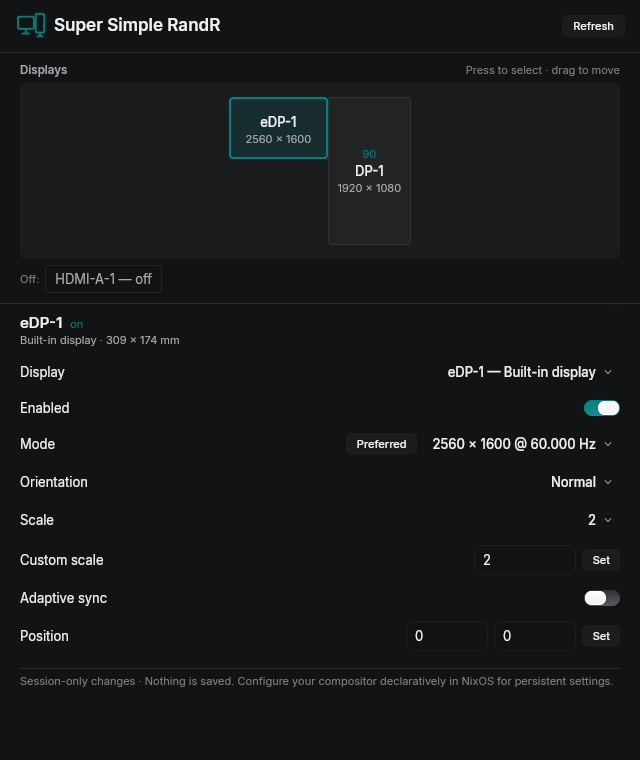

# Super Simple RandR

A native Wayland display-settings app in Rust and [Rune](https://github.com/anomalyco/rune), following [Super Simple Defaults](https://github.com/MiPSR/super-simple-defaults): Rune's default appearance with a teal accent.

Displays appear beneath the app name at their logical positions, accounting for scale and rotation. Click to select; drag to reposition with edge snapping. Disabled displays remain selectable below the map.

Settings cover enabling/disabling, resolution and refresh rate, preferred/custom modes, all eight transforms, preset/custom scales, adaptive sync (when reported), and exact X/Y coordinates. Changes apply immediately through `wlr-randr`; **nothing is saved**. The last active display requires confirmation before disabling.

Minimum window width: **640 pixels**, with no maximum.



## NixOS

Requires a running Wayland compositor implementing `wlr-output-management-unstable-v1` (for example Sway or labwc). GNOME, KDE, and other compositors without this protocol are not supported. `wlr-randr` is bundled in the package's runtime PATH.

```sh
nix run github:MiPSR/super-simple-wlr-randr-gui
```

Add a flake input:

```nix
inputs.super-simple-randr.url = "github:MiPSR/super-simple-wlr-randr-gui";
```

Then, in a NixOS module receiving `inputs` through `specialArgs`:

```nix
environment.systemPackages = [
  inputs.super-simple-randr.packages.x86_64-linux.default
];
```

The package installs `ssrr`, the alias `super-simple-wlr-randr-gui`, and a desktop entry.

Persistence belongs to your compositor's Sway/labwc or Home Manager configuration. This app does not edit Nix files, generate startup scripts, or save profiles. A compositor restart generally restores its configured layout.

## Development

```sh
nix develop
cargo run
cargo test -- --test-threads=1
nix build -L --cores 2
```

Rune's built-in headless fixture scene can be inspected without a Wayland session:

```sh
cargo run -- --scene fixture --at 0.5 --snap /tmp/opencode/randr.png
```

Fixture mode never applies real display changes. Live queries and changes run off the UI thread, with timeouts; the app periodically refreshes external changes.

### Limitations

- `wlr-randr` does not print custom-mode dimensions in its text output. Such displays use a labelled placeholder size in the map until a listed mode is selected.
- A successful compositor request is not a guarantee that the resulting display is usable. There is no automatic timed rollback; use care with custom modes and disabling displays.
- The current flake targets `x86_64-linux`, like the reference app.

## License and credits

AGPL-3.0; see [LICENSE](LICENSE). Rune integration, theming, and portal appearance handling are adapted from Super Simple Defaults. Developed with OpenCode and OpenAI GPT-6.1 Sol.
